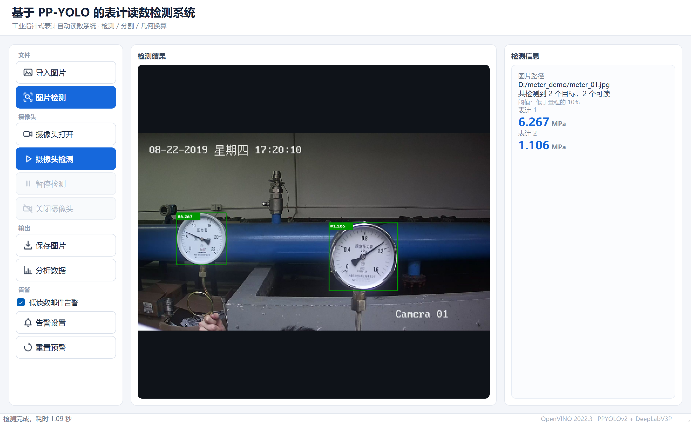
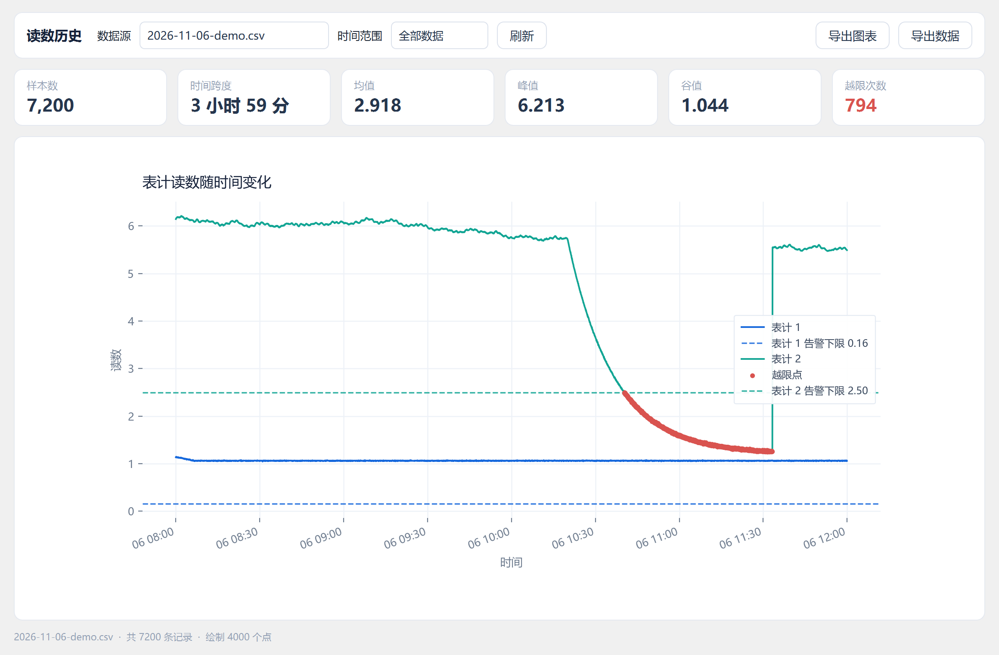
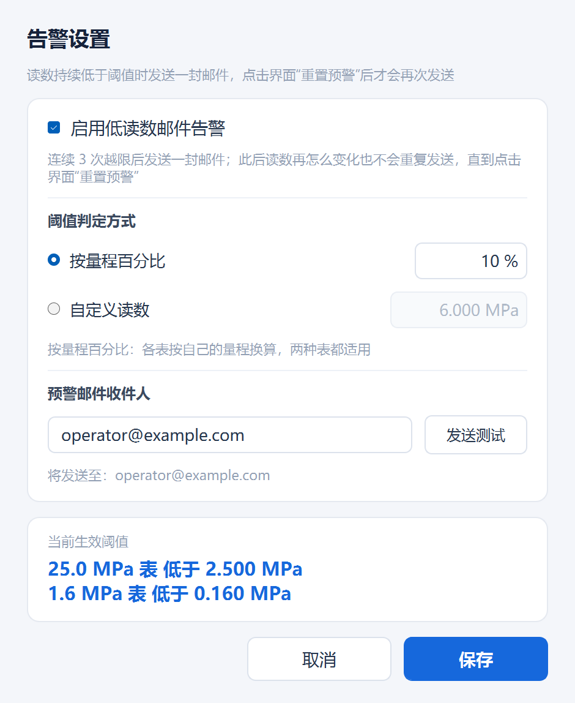

# 基于 PP-YOLO 的工业表计读数检测系统

用摄像头或相机照片自动读出工业指针式压力表的数值。检测用 **PPYOLOv2** 定位表盘，
分割用 **DeepLabV3P** 提取指针与刻度，再按极坐标展开 + 刻度游程定位做几何换算，
最后线性插值得到读数。整个推理基于 **OpenVINO**，CPU 即可运行，不需要独立显卡。



## 功能

| 功能 | 说明 |
|---|---|
| 图片检测 | 导入一张照片，框出所有表盘并给出读数 |
| 摄像头实时检测 | 笔记本摄像头实时读数，采集 / 推理 / 显示三段解耦，界面不会卡 |
| 多表同时识别 | 一张图里有几块表就报几个读数，互不干扰 |
| 低读数邮件告警 | 连续 N 帧低于阈值 → 发**一封**邮件 → 锁定，人工处理完点「重置预警」才会再次发送 |
| 读数落盘 | 按天写入 CSV，每块表每秒最多一条，只记平滑后的稳定值 |
| 数据分析 | KPI 概览、多表曲线、告警下限虚线、越限点高亮、时间筛选、导出图表与数据 |

## 目录结构

```
.
├── detect_logic.py              # 主窗口逻辑：按钮调度、线程编排、结果展示
├── detect_ui.py                 # 界面构建（纯代码，无 .ui 文件）
├── styles.py                    # QSS 主题（浅色扁平）
├── camera.py                    # 采集线程 / 推理线程 / 多帧平滑 / 画面标注
├── pre.py                       # 推理流水线（检测 → 分割 → 几何换算 → 读数）
├── util.py                      # OpenVINO 封装与各步算子
├── alarm.py                     # 告警状态机（只发一封、锁定、重置）
├── mailer.py                    # SMTP 发信（凭据从 mail_config.py 读）
├── recorder.py                  # 读数写 CSV（按天切分）
├── dashboard.py                 # 数据分析看板
├── settings.py                  # 用户设置读写（settings.json）
├── settings_dialog.py           # 告警设置对话框
├── paths.py                     # 资源路径 / 可写目录（兼容 PyInstaller）
├── rthook_openvino.py           # 打包后为 OpenVINO 注册 DLL 搜索路径
├── build_exe.py                 # 一键打包
├── PPYOLO_Meter_Detection.spec  # PyInstaller 配置
├── requirements.txt
├── mail_config.example.py       # 邮件配置模板（复制成 mail_config.py 后填写）
├── model/                       # 模型权重（不在仓库内，见 model/README.md）
├── notebooks/基于PP-YOLO.ipynb   # 训练与导出流程
├── data/meter_test/             # 6 张样例图片，可直接用来试跑
├── csv_data/                    # 读数 CSV，自带 4 份模拟数据
└── docs/screenshots/            # 文档截图
```

## 获取代码

```bash
git clone https://github.com/Jerones/PP-YOLO-DETECTED.git
cd PP-YOLO-DETECTED
```

不想装 git 也可以直接在仓库页点 `Code → Download ZIP` 解压。

克隆下来只有源码，**模型权重和邮箱凭据需要自己补**，见下文第 3 步。

## 快速开始

### 1. 环境要求

- **Windows 10 / 11**（摄像头链路用 DirectShow，其他系统需自行调整 `camera.py` 里的后端常量）
- **Python 3.8**（本项目在 3.8.19 上验证；3.9+ 未测试）
- 不需要 GPU，Intel CPU 即可；内存建议 8 GB 以上

### 2. 安装依赖

用 conda（推荐，与开发环境一致）：

```bash
conda create -n meter python=3.8 -y
conda activate meter
pip install -r requirements.txt -i https://pypi.tuna.tsinghua.edu.cn/simple
```

没有 conda 也可以用 venv：

```bash
python -m venv .venv
.venv\Scripts\activate
pip install -r requirements.txt -i https://pypi.tuna.tsinghua.edu.cn/simple
```

> `openvino` 必须与 `requirements.txt` 保持一致（2022.3.0）。2023 之后 API 从
> `openvino.runtime` 改成了 `openvino`，直接升级会报 ImportError。

### 3. 你需要自己补充的两样东西

仓库**刻意不包含**下面两项，拿到代码后必须自己补上，否则程序跑不起来：

| 必须 | 文件 | 为什么不在仓库里 | 怎么补 |
|---|---|---|---|
| ✅ | `model/` 模型权重 | 单个权重文件 207 MB / 103 MB，超过 GitHub 单文件 100 MB 上限 | 按 [`model/README.md`](model/README.md) 下载官方预训练模型，或自己训练导出 |
| ✅ | `mail_config.py` | 含邮箱授权码，属于个人凭据，不能公开 | 复制 `mail_config.example.py` 为 `mail_config.py`，填入发件邮箱与授权码 |

```bash
# 第 1 步：放模型，最终应得到
#   model/meter_det_model/model.pdmodel + model.pdiparams
#   model/meter_seg_model/model.pdmodel + model.pdiparams

# 第 2 步：配邮箱（不配也能跑，只是邮件告警不可用）
copy mail_config.example.py mail_config.py
notepad mail_config.py
```

`mail_config.py` 里需要填四项：

```python
SENDER = 'your_account@qq.com'      # 发件邮箱
AUTH_CODE = 'your_auth_code'        # 邮箱授权码，不是登录密码
DEFAULT_TO = 'receiver@example.com'  # 默认收件人（界面里也能改）
SMTP_HOST = 'smtp.qq.com'           # 换服务商时改
```

> **QQ 邮箱授权码怎么拿**：登录 QQ 邮箱 → 设置 → 账户 → 开启「POP3/SMTP 服务」→
> 生成授权码（16 位字母）。用 QQ 登录密码去 SMTP 登录会被服务器直接拒绝。
> 163 邮箱同理，记得把 `SMTP_HOST` 改成 `smtp.163.com`。

### 4. 运行

```bash
python detect_logic.py
```

Windows 下也可以直接双击 `run.bat`。

首次启动约 1 秒出窗口，模型在后台加载（约 2 秒），加载完成后检测类按钮才可点。
用 `data/meter_test/` 里的图片点一次「图片检测」即可验证环境是否正常，
正常时两块表分别显示 `6.267 MPa` 和 `1.106 MPa`。

## 使用说明

### 图片检测

「导入图片」选一张照片 → 「图片检测」。检测在后台线程执行，约 1.1 秒，期间界面可继续操作。
右侧面板列出每块表的读数和图片路径，图上框出表盘并标注读数。

### 摄像头检测

「摄像头打开」→「摄像头检测」，开始实时读数；「暂停检测」停止推理但保留画面，
「关闭摄像头」释放设备。摄像头锁定 1280×720：

> 640×480 这类 4:3 分辨率会把刻度漏检到 40 个以下，导致 25 MPa 的表被误判成
> 1.6 MPa 表（读数从 6.267 变成 0.549）。非 16:9 的图片会自动补边到 16:9 再推理。

### 低读数告警

勾选左栏「低读数邮件告警」后生效，规则是：

1. 某块表连续 **3 次**（可调）低于阈值 → 发**一封**邮件，然后进入锁定
2. 锁定期间读数再怎么波动都不再发信——避免现场反复刷屏
3. 管理人员处理完，在界面点「重置预警」解锁，下次再低于阈值才会发下一封

阈值有两种判定方式（「告警设置」里切换）：

- **按量程百分比**（默认 10%）：1.6 MPa 表 → 0.16，25 MPa 表 → 2.50
- **自定义读数**：所有表统一用一个固定值

「告警设置」里可以改收件人（支持多个，用逗号分隔，最多 5 个）并直接「发送测试」验证通道。

预警发出后，左栏「重置预警」按钮会变成红色，右侧信息栏常驻一条提示，方便交接班。

### 数据分析

点「分析数据」打开看板：六个 KPI（样本数 / 时间跨度 / 均值 / 峰值 / 谷值 / 越限次数）、
按表分色的曲线、告警下限虚线与红色越限点、时间范围筛选，以及导出 PNG 图表和筛选后的 CSV。



数据量很大时会按 min/max 包络降采样到 4000 点，尖峰不会被抹掉（3 万行实测重绘 155 ms）。

### 告警设置



## 打包成 exe

```bash
python build_exe.py
```

产物在 `dist/PPYOLO_Meter_Detection/PPYOLO_Meter_Detection.exe`，整个文件夹一起拷走即可运行。
打包前请确认 `model/` 与 `mail_config.py` 已就位，脚本会先检查模型是否存在。

几个已经踩过的坑，配置里都处理好了，改动时注意别破坏：

- 用 **onedir** 而不是 onefile：315 MB 模型在 onefile 下每次启动都要解压，会等几十秒
- 必须收集 `openvino/libs` 下的 17 个 DLL 与 `plugins.xml`，并靠 `rthook_openvino.py` 注册搜索路径，否则打包后报 `DLL load failed`
- `pre` / `dashboard` 是函数内延迟导入，显式写进 `hiddenimports` 更保险
- 排除 `paddle` / `torch`：推理只走 OpenVINO，留着不仅体积大，还会因 protobuf 描述符冲突导致启动崩溃
- 改了代码重新打包前先删 `build/` 和 `dist/`，避免旧文件混入

调试启动问题可以保留控制台：

```bash
set PPYOLO_CONSOLE=1 && python build_exe.py
```

## 配置文件

### settings.json（程序自动生成，与 exe 同级）

| 字段 | 含义 | 默认 |
|---|---|---|
| `alarm_enabled` | 是否启用邮件告警 | `true` |
| `threshold_mode` | `ratio` 按量程百分比 / `value` 自定义读数 | `ratio` |
| `alarm_ratio` | 百分比阈值，0.10 表示量程的 10% | `0.10` |
| `alarm_value` | 自定义读数阈值 | `6.0` |
| `alarm_consecutive` | 连续多少次越限才发信 | `3` |
| `mail_to` | 收件邮箱，多个用逗号分隔 | 取自 `mail_config.py` |

数值越界会被自动收敛到合理区间，文件损坏时回落到默认值，不会导致程序起不来。

### 读数 CSV 格式

`csv_data/YYYY-MM-DD.csv`，按天切分，UTF-8：

```
time,meter_id,scale,range,unit
2026-11-06 08:00:00,1,1.139456,1.6,MPa
2026-11-06 08:00:00,2,6.152,25.0,MPa
```

`range` 是该表量程，看板用它算告警下限；早期只有 `time,scale` 两列的文件也能读，
量程会按读数量级反推并在图例标注「推断」。

## 换成自己的模型

1. 用 PaddleDetection 训练 PPYOLOv2（检测）与 PaddleSeg 训练 DeepLabV3P（分割），
   流程见 `notebooks/基于PP-YOLO.ipynb`
2. 用各自仓库的 `export.py` 导出 inference model
3. 覆盖 `model/meter_det_model/`、`model/meter_seg_model/` 下的 `model.pdmodel` 与 `model.pdiparams`
4. 如果输入尺寸变了，同步改 `pre.py` 顶部的 `DET_MODEL_SHAPE` / `SEG_MODEL_SHAPE`

分割模型输出 3 类（背景 / 指针 / 刻度），几何换算默认按 512×512 标签图计算，
改分割输入尺寸时务必同步 `util.py` 里的 `METER_CONFIG`。

## 常见问题

**摄像头打不开 / 提示设备被占用**
先关掉微信视频、钉钉、其他占用摄像头的程序。程序退出时会释放设备，异常退出后重启一次即可。

**首帧特别慢**
第一帧要做模型编译，约 1 秒；之后每帧才 1 秒左右（检测 ~200 ms + 每块表分割 ~400 ms）。
两块表时整体约 1 fps，这是模型算力上限，不是代码问题。

**读数不准 / 表型判断反了**
先确认输入是 16:9、表盘在画面中占比够大（建议表盘直径 ≥ 画面高度的 1/5），
且刻度线清晰不反光。640×480 等 4:3 分辨率会漏检刻度，必然误判。

**邮件发不出去**
按顺序排查：`mail_config.py` 是否填了授权码（不是登录密码）→ 是否开了 SMTP 服务 →
465 端口是否被公司网络或防火墙拦截 → 用「告警设置」里的「发送测试」看具体报错。
发信超时设为 15 秒，失败原因会显示在状态栏。

**报 `ImportError: cannot import name 'runtime' from 'openvino'`**
装了 OpenVINO 2023+。执行 `pip install openvino==2022.3.0` 降回指定版本。

**中文路径保存图片失败**
代码已用 `cv2.imdecode` / `imencode` 处理中文路径；若自己扩展功能，注意不要直接用
`cv2.imread` / `imwrite`。

## 说明

- 仓库内**不含任何个人信息**：源码里没有硬编码的邮箱、授权码；`settings.json`、
  真实读数记录、模型权重、IDE 配置均通过 `.gitignore` 排除
- 想用自己的邮箱发告警，按上文第 3 步新建 `mail_config.py` 即可，改完重启程序生效
- 训练所用的 PPYOLOv2、DeepLabV3P 结构与 PaddleX 官方 meter_reader 示例一致，
  遵循其原始开源许可；本项目代码仅供学习交流

## 参考

- [PaddleDetection](https://github.com/PaddlePaddle/PaddleDetection) — PPYOLOv2 检测模型
- [PaddleSeg](https://github.com/PaddlePaddle/PaddleSeg) — DeepLabV3P 分割模型
- [PaddleX meter_reader](https://github.com/PaddlePaddle/PaddleX) — 表计读数示例与预训练模型
- [OpenVINO](https://docs.openvino.ai/2022.3/) — CPU 推理加速
